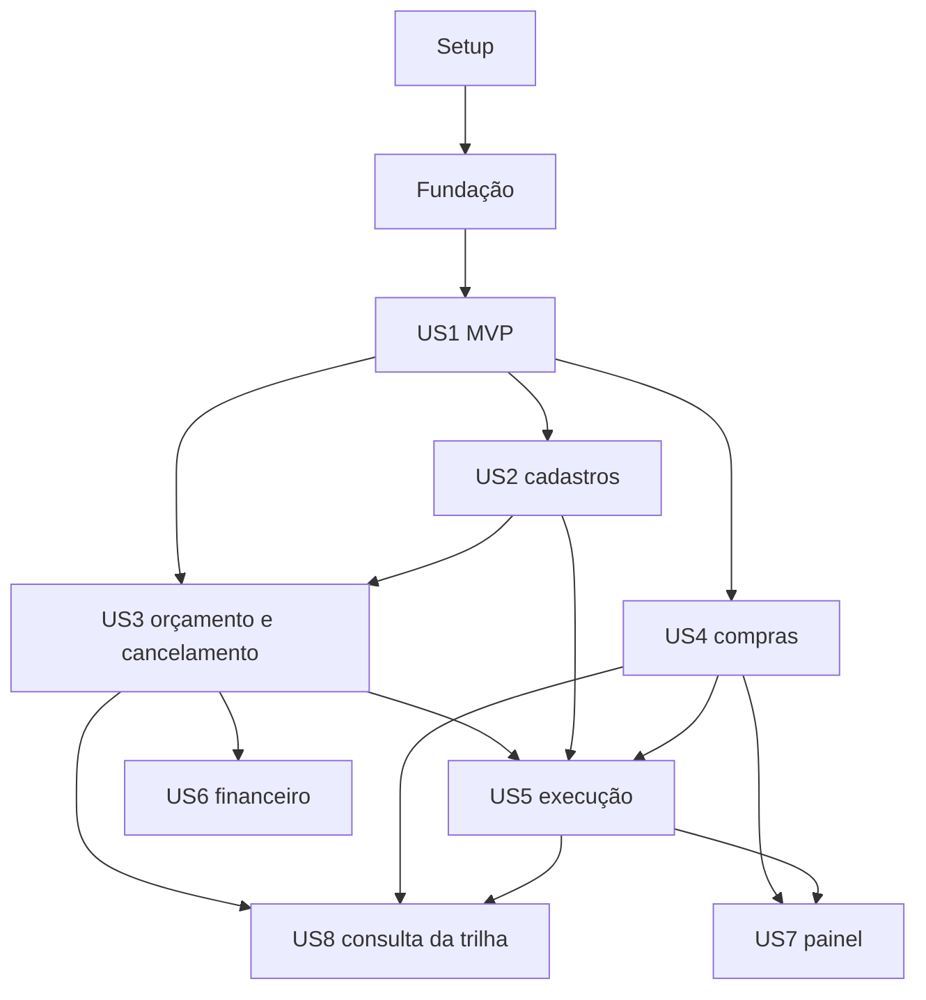

# Tasks: Reimplementar o núcleo da farm

**Input**: `specs/001-reimplementar-printfarm/`
**Prerequisites**: [spec.md](spec.md), [plan.md](plan.md), [research.md](research.md), [data-model.md](data-model.md), contratos e [quickstart.md](quickstart.md).
**Branch**: `001-reimplementar-printfarm`
**Tests**: O princípio II da constituição e o plano exigem teste automatizado vermelho antes de regra nova ou alterada. Arquivos em src/Farm3d.Tests/Domain usam o trait Category=Domain; arquivos em Stock e Contracts usam Category=StockIntegration com SQL Server exclusivo. Vitest cobre o guarda da SPA. Testes HTTP são focados nos contratos e ações de risco, sem suíte exaustiva por endpoint.
**Organization**: Setup, fundação, oito histórias por prioridade e validação. Cada história admite prova com seus dados semeados; dependências de modelos e infraestrutura são explícitas abaixo. Nenhuma tarefa foi executada nesta geração.

## Formato e execução

- Cada tarefa usa checkbox, ID sequencial, marcador [P] somente para arquivos independentes e [USn] somente nas fases de histórias.
- Dependências citadas precisam estar concluídas. [P] autoriza trabalho em arquivos distintos somente depois dos pré-requisitos comuns; não autoriza executar fases dependentes ao mesmo tempo.
- Para obter teste vermelho, criar apenas assinaturas ou estruturas mínimas necessárias e falhar em execução por comportamento ausente. Erro de compilação isolado não é evidência de teste de regra. Depois implementar o mínimo até ficar verde.
- Frases de restrição foram copiadas literalmente de data-model.md nas tarefas dos modelos. Elas não antecipam endpoints ou ações de histórias futuras. Regras de domínio ficam em Domain, I/O em Infrastructure, orquestração em Application e composição em Api/Program.cs.
- Em cada tarefa concluída, atualizar este arquivo e pr.md. Marcar aceitação somente com teste real no branch, usando `→ teste: tests/...` conforme o template e o caminho real da suíte, e manter cenários USn-ASk verbatim. Não transformar metas estatísticas em critérios de PR nem marcar prova planejada como executada.
- Não fazer commit sem autorização. Quando autorizado, stage explícito e commits de spec/tarefas separados do código. Preparar PR real só se solicitado, com rebase no alvo atual, descrição PT-BR de pr.md e nota do modelo/harness usados.
- Antes de interface não trivial, publicar várias alternativas estáticas pelo skill html-communication e aguardar escolha explícita. Fundo #000, texto principal branco, informação densa, cópia mínima, sem chrome decorativo, subtítulos cinza acima de seção, em dashes ou animação contínua. Enquanto uma escolha visual estiver pendente, só prosseguir em trabalho independente autorizado.
- Caminhos de tarefas são relativos à raiz. Dados de exemplo são fictícios; só operar bancos e processos de teste isolados e criados para a execução. Produção e canais de uso diário exigem autorização explícita.

## Convenções de caminhos

Domínio em `src/Farm3d.Domain/`, casos de uso e limites em `src/Farm3d.Application/`, I/O em `src/Farm3d.Infrastructure/`, HTTP/composição em `src/Farm3d.Api/`, testes em `src/Farm3d.Tests/` e SPA em `web/`. Modelos e endpoints aparecem na primeira história que os exige. Schema consultado pelo cancelamento entra na US3; iniciar/falhar e lançar financeiro continuam nas US5/US6.

## Phase 1: Setup

**Goal**: Preparar solução, SPA, configuração local e evidência do escopo escolhido para implementação.

- [ ] T001 No início da implementação, copiar `.github/pr-template.md` para `specs/001-reimplementar-printfarm/pr.md`; preencher feature, branch, IDs do incremento selecionado e cenários verbatim USn-ASk do spec, em PT-BR. Deixar critérios sem teste desmarcados, registrar desvios e identificar o modelo e harness efetivamente usados; preencher hashes e datas só quando houver commits autorizados. Não executar tarefas fora do escopo listado no PR.
- [ ] T002 Criar `Farm3d.sln` e `src/Farm3d.Domain/Farm3d.Domain.csproj`, `src/Farm3d.Application/Farm3d.Application.csproj`, `src/Farm3d.Infrastructure/Farm3d.Infrastructure.csproj`, `src/Farm3d.Api/Farm3d.Api.csproj`, `src/Farm3d.Tests/Farm3d.Tests.csproj` em net8.0; referências apontam para Domain, Application depende de Domain e Infrastructure implementa os limites de Application; Api é composição. Tests usa xUnit e referencia Domain, Application e Infrastructure. Domain não recebe EF, HTTP ou UI. Depende de T001.
- [ ] T003 [P] Configurar nullable e implicit usings em `src/Directory.Build.props`, com anotações precisas e análise de nulabilidade habilitada. Depende de T002.
- [ ] T004 [P] Criar SPA Vue 3, Vite 6, TypeScript, Vue Router e Vitest em `web/package.json`, `web/tsconfig.json` e `web/vite.config.ts`; scripts dev, test e build. Não criar componentes de produto antes da escolha dos mocks. Depende de T002.
- [ ] T005 [P] Criar `docker-compose.yml`, `.env.example` e `.gitignore` com SQL Server 2022 local, senha via MSSQL_SA_PASSWORD, ConnectionStrings__Farm3d, Jwt__SigningKey, FARM3D_SEED_PASSWORD e FARM3D_TEST_CONNECTION; ignorar .env e data/files3d. Separar a instância exclusiva de testes da aplicação, sem iniciar nem alterar canais de uso diário sem autorização. Depende de T002.
- [ ] T006 [P] Configurar `./.editorconfig` com 4 espaços em C# e 2 em TypeScript e Vue, seguindo os formatos escolhidos no plano. Depende de T002.
- [ ] T007 Criar `src/Farm3d.Api/appsettings.json` sem segredos e configuração da API local na porta 5088; documentar em `.env.example` como carregar as variáveis e falhar na inicialização por chave JWT ausente fora de Development. Depende de T003, T005.

**Checkpoint**: Concluir T007 e os pré-requisitos desta fase antes do próximo incremento.

## Phase 2: Foundational

**Goal**: Disponibilizar identidade, transações, isolamento dos testes, captura de auditoria e entrada da SPA. Bloqueia as histórias.

- [ ] T008 Criar os enums em `src/Farm3d.Domain/Enums/AppRole.cs`, `src/Farm3d.Domain/Enums/MaterialKind.cs`, `src/Farm3d.Domain/Enums/QuoteStatus.cs`, `src/Farm3d.Domain/Enums/CommercialOrderStatus.cs`, `src/Farm3d.Domain/Enums/ProductionLotStatus.cs`, `src/Farm3d.Domain/Enums/PrinterOperationalStatus.cs`, `src/Farm3d.Domain/Enums/PrintRunStatus.cs`, `src/Farm3d.Domain/Enums/PrintFailureReason.cs`, `src/Farm3d.Domain/Enums/PurchaseOrderStatus.cs`, `src/Farm3d.Domain/Enums/StockMovementKind.cs`, `src/Farm3d.Domain/Enums/PaymentMethod.cs`. Valores literais: AppRole: "Admin, Sales, Production, Purchasing, Operator"; MaterialKind: "Filament, Resin, SparePart, Packaging, Other"; QuoteStatus: "Draft, Sent, Approved, Rejected, Expired, OrderGenerated"; CommercialOrderStatus: "QuotePending, Approved, InProduction, AwaitingFinishing, ReadyToShip, Delivered, Cancelled"; ProductionLotStatus: "AwaitingPlanning, Released, Queued, Printing, Paused, AwaitingPickup, Completed, Failed, Cancelled"; PrinterOperationalStatus: "Available, Printing, AwaitingPickup, Preparing, InMaintenance, Unavailable"; PrintRunStatus: "Planned, Running, Paused, Failed, Completed"; PrintFailureReason: "None, BedAdhesion, Clog, LayerShift, OutOfMaterial, Other"; PurchaseOrderStatus: "Draft, Sent, PartiallyReceived, Received, Cancelled"; StockMovementKind: "PurchaseIn, ProductionOut, Adjustment, Reserve, Unreserve, Waste"; PaymentMethod: "Cash, Card, Pix, BankTransfer, Other". Não acrescentar estado de falta de material.
- [ ] T009 Escrever `src/Farm3d.Tests/Domain/FarmSettingsTests.cs` com Category=Domain e obter falha para tentativa de desmarcar exemplos fictícios, tarifa negativa e calendário vazio; aceitar tarifa ausente como premissa faltante. FR-023 e FR-025.
- [ ] T010 Criar `src/Farm3d.Domain/Entities/FarmSettings.cs` e suas validações até T009 passar. Restrições literais: EnergyTariffPerKwh: "decimal opcional. Nulo significa premissa ausente."; CalendarSummary: "texto obrigatório. Padrão: "segunda a sexta, 08:00–18:00"."; WorkDays: "flags. Padrão: segunda a sexta."; WorkStart / WorkEnd: "hora local. Padrão: 08:00 e 18:00."; ExamplesAreFictional: "bool. MUST permanecer verdadeiro enquanto os números de exemplo não forem série medida.". FR-023 e FR-025. Depende de T009.
- [ ] T011 Configurar o usuário do Identity em `src/Farm3d.Infrastructure/Identity/ApplicationUser.cs`: e-mail único, nome, um papel entre os cinco autorizados e senha somente como hash. Identidade fica fora do domínio; não devolver senha ou hash em contratos. FR-001 e FR-002. Depende de T008.
- [ ] T012 Criar `src/Farm3d.Infrastructure/Persistence/Farm3dDbContext.cs` e `src/Farm3d.Infrastructure/Persistence/Migrations/Initial.cs` com Identity e FarmSettings. Mapear dinheiro decimal em centavos, gramas com três casas e instantes DateTimeOffset. Nenhum saldo agregado pode duplicar estoque movimentável. Depende de T010, T011.
- [ ] T013 Definir o limite de transação em `src/Farm3d.Application/Ports/IFarmTransaction.cs` e implementar em `src/Farm3d.Infrastructure/Persistence/FarmTransaction.cs`; incluir leituras e gravações em Serializable, acesso ordenado e rollback integral, sem retries automáticos. Traduzir deadlocks com rollback confirmado em conflito e falhas técnicas ou commit incerto em erro de infraestrutura com causa preservada; não vazar EF em Application. FR-012, FR-017 e FR-024. Depende de T012.
- [ ] T014 Criar `src/Farm3d.Tests/Support/SqlServerFixture.cs` para Category=StockIntegration; exigir FARM3D_TEST_CONNECTION, criar banco Farm3dTest_<identificador> exclusivo, aplicar migrations e remover apenas o banco criado. Permitir contextos e conexões independentes por teste; não substituir por InMemory, não ignorar teste sem conexão e não compartilhar dados mutáveis entre casos. Depende de T012.
- [ ] T015 Criar `src/Farm3d.Tests/Support/ApiFixture.cs` que sobe processo isolado da API em endereço loopback e porta livre, com o banco exclusivo de T014 e HttpClient; encerrar apenas o processo criado. Reutilizar infraestrutura real, sem simular casos de uso internos ou adicionar suíte HTTP para endpoints sem comportamento relevante. Depende de T014.
- [ ] T016 [P] Escrever `src/Farm3d.Tests/Contracts/AuthContractTests.cs` usando T015 e Category=StockIntegration; provar login e 401 genérico para credenciais inválidas, sem dados secretos na resposta; obter falha antes do login. FR-001. Depende de T015.
- [ ] T017 [P] Escrever primeiro `web/tests/route-guard.spec.ts` provando redirecionamento de /fila sem sessão para /entrar e restrição por papel; obter falha antes do guarda. FR-001. Depende de T004.
- [ ] T018 Implementar autenticação em `src/Farm3d.Infrastructure/Identity/IdentitySeed.cs`, `src/Farm3d.Infrastructure/Identity/PasswordAuthentication.cs` e `src/Farm3d.Api/Controllers/AuthController.cs` para o contrato coberto por T016; a prova HTTP fica verde após a composição de T019. Usar cinco usuários do quickstart só em Development, senha via FARM3D_SEED_PASSWORD, travamento de login e resposta genérica. FR-001 e FR-002. Depende de T016, T011.
- [ ] T019 Configurar JWT, políticas dos papéis, composição dos limites e do login até T016 passar, HTTPS fora de Development, CORS explícito e Problem Details em `src/Farm3d.Api/Program.cs`; manter regra de domínio fora dos controllers. 400 para dados inválidos, 401/403 para acesso, 409 para conflito confirmado e 503 para falha técnica ou commit incerto; logs com contexto e sem segredos. FR-001 e FR-026. Depende de T013, T018.
- [ ] T020 Implementar `web/src/router/index.ts` e `web/src/stores/session.ts` até T017 passar, com tipos precisos, tratamento explícito de erro e consumo do contrato auth; não criar interface de login nesta tarefa. Depende de T017, T019.
- [ ] T021 Preparar várias alternativas estáticas de entrada e navegação em `specs/001-reimplementar-printfarm/mocks/entrada.html`, publicar com html-communication, informar URL e parar a parte visual até Jorge escolher. Aplicar fundo #000, texto principal branco, densidade, cópia mínima e sem cards decorativos, em dashes ou animações contínuas. Depende de T020.
- [ ] T022 Após escolha explícita de T021, implementar `web/src/pages/EntrarPage.vue` e `web/src/App.vue` com a alternativa aprovada, usando login e erros do contrato. FR-001. Depende de T021.
- [ ] T023 Criar `src/Farm3d.Domain/Entities/AuditLog.cs`, `src/Farm3d.Application/UseCases/AuditWriter.cs` e mapeamento em `src/Farm3d.Infrastructure/Persistence/Configurations/AuditLogConfiguration.cs`; a captura participa da transação de cada história desde US1, sem esperar US8. Migration `src/Farm3d.Infrastructure/Persistence/Migrations/AuditCapture.cs`. FR-024. Restrições literais de data-model.md: AuditLog: "EntityName; EntityId; Action; UserId; At; FromStatus; ToStatus. "Trilha guarda entidade, ação, usuário, momento, estado anterior e estado novo." Leitura: Admin e Production." Depende de T013.
- [ ] T024 Criar o agendador vazio de intervalo horário em `src/Farm3d.Infrastructure/Jobs/HourlyFarmJob.cs`, sem banco ou painel de jobs adicional, e registrá-lo em `src/Farm3d.Api/Program.cs`; cada efeito de negócio será acrescentado na história correspondente. Depende de T019.
- [ ] T025 Criar `src/Farm3d.Tests/Domain/DomainPurityTests.cs` com Category=Domain para conferir dependências do assembly de domínio e recusar EF, HTTP, UI e container, conforme o gate do princípio I. Verificar também `src/Farm3d.Domain/Farm3d.Domain.csproj`, executar os testes de pureza, autenticação e guarda e registrar comandos/resultados em `specs/001-reimplementar-printfarm/pr.md`. Domain deve compilar sem dependência de EF, HTTP, UI ou container; conferir que o teste SQL realmente executou. Depende de T022, T023, T024.

**Checkpoint**: Concluir T025 e os pré-requisitos desta fase antes do próximo incremento.

## Phase 3: User Story 1 - Pedido aprovado vira lotes na fila (Priority: P1)

**Goal**: Confirmar pedido semeado, cortar 10 peças em 4/4/2, reservar integralmente, criar fila e preservar os parâmetros da liberação. MVP.

**Independent Test**: Com dados semeados, executar a seção 1 do quickstart. Provar US1-AS1 a US1-AS8; US1-AS9 usa os mesmos parâmetros preservados e será exercitado ponta a ponta com reimpressão na US5.

### Testes antes das regras

- [ ] T026 [P] [US1] Escrever e executar em vermelho `src/Farm3d.Tests/Domain/LotSplitTests.cs`: 10/4 resulta em 4/4/2 e tempos/gramas 100%/100%/50%; quantidade zero, negativa e peças por prancha ausentes ou menores que 1 recusadas. FR-011; US1-AS1.
- [ ] T027 [P] [US1] Escrever em vermelho `src/Farm3d.Tests/Domain/FifoReservationTests.cs`: ReceivedAt e Id ordenam a reserva, falta mínima de 0,001 g não é ocultada e saldo insuficiente não devolve alocação parcial; saldo negativo ou reservado maior que quantidade é recusado. FR-012; US1-AS2 e US1-AS6.
- [ ] T028 [P] [US1] Escrever em vermelho `src/Farm3d.Tests/Domain/PrinterCompatibilityTests.cs`: lista vazia aceita qualquer material, incompatibilidade, inatividade, ocupação e indisponibilidade recusam atribuição. FR-005 e FR-013; US1-AS3 e US1-AS4.
- [ ] T029 [P] [US1] Escrever em vermelho `src/Farm3d.Tests/Domain/ProductionDataTests.cs`: perfil com valores positivos, manutenção maior que zero, preço de venda distinto de custo e parâmetros já liberados preservados após edição do perfil. FR-004, FR-005 e FR-011; US1-AS8.
- [ ] T030 [P] [US1] Escrever em vermelho `src/Farm3d.Tests/Stock/ReleaseLotsTests.cs` com SQL Server: fila inicial Queued sem impressora, snapshots 4/60/40, recusa integral da linha quando falta saldo inclusive para o último lote, repetição, pedido pendente, movimentos Reserve e trilha de Released/Queued com autor. Injetar falha de persistência entre gravações e disputar saldo por duas conexões. FR-009, FR-011, FR-012 e FR-024; US1-AS1 a US1-AS8.
- [ ] T031 [P] [US1] Escrever em vermelho `src/Farm3d.Tests/Contracts/ProductionQueueContractTests.cs` para release, GET de fila e queue de `contracts/producao.md`; verificar campos released*, reserva, impedimentos, 201/200/409 e regras de papel. Usar HTTP real e SQL isolado. FR-011, FR-012 e FR-013.
- [ ] T032 [P] [US1] Escrever em vermelho `src/Farm3d.Tests/Domain/OrderReleaseGuardTests.cs` para confirmação manual e recusa de produção em QuotePending ou Cancelled, quantidade inválida e cor/tamanho obrigatórios apenas quando oferecidos. FR-009; US1-AS5.

### Modelos, regras e integração

- [ ] T033 [P] [US1] Criar `src/Farm3d.Domain/Entities/Color.cs`, `src/Farm3d.Domain/Entities/Product.cs`, `src/Farm3d.Domain/Entities/PrintProfile.cs`, `src/Farm3d.Domain/Entities/Printer.cs` e `src/Farm3d.Domain/Entities/PrinterMaterial.cs`; implementar as validações de cadastro/liberação cobertas por T029. Não implementar eventos de execução antes de US5. FR-004 e FR-005. Restrições literais de data-model.md: Color: "Name obrigatório; Hex opcional no formato `#RRGGBB`." PrintProfile: "Name obrigatório; PiecesPerPlate ≥ 1 inteiro; MinutesPerPlate > 0; GramsPerPlate > 0; MaterialId opcional. "Peças por prancha, minutos por prancha e gramas por prancha, todos maiores que zero."" Product: "Name e Sku obrigatórios, Sku único; DefaultSellPrice ≥ 0; DefaultPrintProfileId obrigatório para liberar; IsForSale bool; listas de ColorId e tamanhos (texto curto) oferecidos. Preço de venda não é custo." Printer: "OccupyingPrintRunId opcional identifica a execução na mesa desde o início até a retirada, inclusive depois de falhar ou concluir. Criar reimpressão não troca esse vínculo. Name obrigatório; CostPerHour ≥ 0; EnergyKwhPerHour nulo ou ≥ 0; MaintenanceLimitHours > 0; AccumulatedHours ≥ 0; PreparationMinutes ≥ 0; IsActive; OperationalStatus; HourRateExcludesFilamentAndEnergy MUST ser verdadeiro e não editável. "Limite de horas de manutenção maior que zero." "A taxa de hora-máquina não inclui filamento nem energia."" PrinterMaterial: "par PrinterId + MaterialId. Lista vazia significa compatível com qualquer material." Depende de T029.
- [ ] T034 [P] [US1] Criar `src/Farm3d.Domain/Entities/Supplier.cs`, `src/Farm3d.Domain/Entities/Material.cs`, `src/Farm3d.Domain/Entities/MaterialLot.cs`, `src/Farm3d.Domain/Entities/StockItem.cs` e `src/Farm3d.Domain/Entities/StockMovement.cs`; fornecedor entra aqui porque MaterialLot exige sua identidade. Ainda não expor compras ou consumo terminal. FR-003, FR-012 e FR-024. Restrições literais de data-model.md: Supplier: "Name obrigatório; PaymentTerms e AverageLeadTimeDays opcionais; contato opcional." Material: "Name obrigatório; Kind obrigatório; ReferenceCostPerKg ≥ 0; ReorderPointGrams nulo ou ≥ 0; DiameterMm nulo ou > 0; ColorId opcional." MaterialLot: "MaterialId e SupplierId obrigatórios; LotCode obrigatório e único por material; ReceivedAt obrigatório; InitialWeightG > 0; CurrentWeightG ≥ 0 e ≤ InitialWeightG; CostPerGram ≥ 0." StockItem: "MaterialId obrigatório; MaterialLotId opcional (nulo = agregado do material, não usado na reserva); QuantityG ≥ 0; ReservedG ≥ 0; ReservedG ≤ QuantityG. Livre = QuantityG − ReservedG." StockMovement: "Kind obrigatório; QuantityG > 0; UnitCost ≥ 0; CreatedAt; UserId; StockItemId e MaterialLotId identificam o saldo e o custo afetados; origem em ProductionLotId, PrintRunId ou PurchaseReceiptId conforme a ação. Consumo terminal exige PrintRunId e ProductionLotId. Consumo de vários lotes de material gera um detalhe por origem; parcelas de reserva própria e saldo livre do mesmo StockItem são somadas no mesmo detalhe. Os detalhes são agrupados por PrintRunId como uma única baixa lógica; soma das saídas do grupo = ActualMaterialG. ProductionOut identifica conclusão e Waste identifica falha. Zero na falha não gera saída. Índice único em PrintRunId + StockItemId para movimentos terminais ProductionOut ou Waste impede duas linhas terminais para a mesma origem na mesma execução. "Movimentação guarda tipo, gramas, custo unitário e origem."" Depende de T027.
- [ ] T035 [P] [US1] Criar `src/Farm3d.Domain/Entities/Customer.cs`, `src/Farm3d.Domain/Entities/SalesOrder.cs`, `src/Farm3d.Domain/Entities/OrderLine.cs`, `src/Farm3d.Domain/Entities/ProductionLot.cs`, `src/Farm3d.Domain/Entities/ProductionMaterialReservation.cs` e `src/Farm3d.Domain/Entities/PrintQueueItem.cs`; implementar só confirmação/liberação nesta fase. Cancelamento com consulta de execuções e financeiro pertence a T062. FR-009, FR-011 e FR-012. Restrições literais de data-model.md: Customer: "Name obrigatório; Email, Phone, Address opcionais; CreatedAt." SalesOrder: "Number único; CustomerId; QuoteId opcional; CommercialStatus; PromisedDate opcional no rascunho manual e obrigatória na geração por orçamento; FreightAmount ≥ 0; PackagingAmount ≥ 0; Notes. Pedido manual nasce QuotePending. De QuotePending só para Approved ou Cancelled. Cancelled não muda. Cancelamento permitido em QuotePending, Approved ou InProduction se só houve planejamento, sem qualquer PrintRun com StartedAt, Invoice ou Payment. A consulta inclui execuções já encerradas. Cancela ProductionLot pendentes, remove fila e PrintRun Planned sem início, libera reservas e grava trilha em uma operação. Recusa qualquer violação sem alterar dados. "Pedido em confirmação pendente não gera lote de produção, fatura nem pagamento."" OrderLine: "ProductId; Quantity > 0; UnitPrice ≥ 0; MaterialId obrigatório na liberação; ColorId obrigatório se o modelo oferece cores; Size obrigatório se o modelo oferece tamanhos. A escolha fica gravada." ProductionLot: "SalesOrderId; OrderLineId; ProductId; MaterialId; QtyPlanned > 0; QtyCompleted ≥ 0 e ≤ QtyPlanned; Status; PlannedGrams > 0; PlannedMinutes > 0; ReleasedPiecesPerPlate ≥ 1; ReleasedMinutesPerPlate > 0; ReleasedGramsPerPlate > 0; CreatedAt; ReleasedAt opcional; CompletedAt opcional." Parâmetros preservados: "ReleasedPiecesPerPlate, ReleasedMinutesPerPlate e ReleasedGramsPerPlate podem estar ausentes antes de Released; são obrigatórios e copiados do perfil na liberação e não mudam depois dela. PlannedGrams e PlannedMinutes são calculados a partir desses valores uma vez. Editar PrintProfile só afeta liberações futuras. Reimpressões usam o mesmo ProductionLot e não releem o perfil para recalcular." ProductionMaterialReservation: "ProductionLotId; StockItemId; GramsReserved > 0 nas reservas ativas; par ProductionLotId + StockItemId único. Consumo reduz ou encerra a reserva, sem apagar suas movimentações. Uma liberação bem-sucedida cobre PlannedGrams. Após falha, a reserva restante pode ser menor enquanto aguarda complemento; isso não autoriza iniciar. Complemento integral = max de zero e PlannedGrams menos a soma das reservas restantes. "Saldo insuficiente recusa a liberação inteira, sem reserva parcial." "Repetir a liberação já reservada é recusado."" PrintQueueItem: "ProductionLotId único na fila ativa; PrinterId opcional; Priority inteiro; Position inteiro ≥ 1. Consulta inclui reservedGrams e missingMaterialG calculados a partir das reservas próprias e de PlannedGrams. missingMaterialG positivo bloqueia início até completar a reserva. A liberação cria item inicial sem impressora; a atribuição posterior valida compatibilidade e ocupação." Depende de T026, T032.
- [ ] T036 [US1] Implementar `src/Farm3d.Domain/Rules/LotSplit.cs`, `src/Farm3d.Domain/Rules/FifoReservation.cs`, `src/Farm3d.Domain/Rules/PrinterCompatibility.cs` e `src/Farm3d.Domain/Rules/OrderReleaseGuard.cs` até T026, T027, T028 e T032 passarem; domínio recebe valores e devolve decisão/alocação sem I/O. FR-009, FR-011, FR-012 e FR-013. Depende de T033, T034, T035. Restrição literal de data-model.md, Corte: "quantidade de lotes = teto(peças da linha / peças por prancha). Lote cheio: PlannedGrams = GramsPerPlate e PlannedMinutes = MinutesPerPlate. Lote incompleto: ambos × (peças do lote / peças por prancha). "10 peças com 4 por prancha produzem 3 lotes, o último com metade do tempo e metade do material.""
- [ ] T037 [US1] Mapear relacionamentos e índices em `src/Farm3d.Infrastructure/Persistence/Configurations/ProductionConfiguration.cs` e gerar `src/Farm3d.Infrastructure/Persistence/Migrations/ProductionLots.cs`. FK Supplier obrigatório, SKU único, par PrinterMaterial único e fila/reserva sem duplicação. Campos opcionais de origem PrintRun serão relacionados à tabela quando ela entrar em T060; não antecipar suas ações. Depende de T033, T034, T035.
- [ ] T038 [US1] Implementar `src/Farm3d.Application/UseCases/ReleaseLots.cs`, `src/Farm3d.Application/UseCases/ConfirmOrder.cs` e `src/Farm3d.Application/UseCases/EnqueueLot.cs`; usar regras puras, transação Serializable, snapshot dos três parâmetros, reserva integral por linha e fila inicial sem impressora; registrar estado e movimentos desde já. Fazer T030 passar sem InMemory. FR-009, FR-011, FR-012, FR-013 e FR-024. Depende de T030, T036, T037.
- [ ] T039 [US1] Implementar `src/Farm3d.Api/Controllers/LotsController.cs` e o mínimo de confirmação manual em `src/Farm3d.Api/Controllers/SalesOrdersController.cs`; release retorna Queued, GET inclui snapshots e reservedGrams/missingMaterialG, queue atribui sem duplicar. Usar papéis e estados dos contratos de produção/comercial até T031 passar. FR-009, FR-011, FR-012 e FR-013. Depende de T031, T038.
- [ ] T040 [US1] Criar `src/Farm3d.Infrastructure/Identity/DemoSeed.cs` com cliente, fornecedor, modelo Suporte demo (fictício), perfil 4/60/40, dois lotes de material e mesas A compatível/B incompatível, mais pedido manual pendente. Seed restrito a Development e explícito para cada teste, sem copiar código de docs_apoio/software_ref. FR-025 e FR-026. Depende de T037.
- [ ] T041 [US1] Criar alternativas estáticas de pedido e fila em `specs/001-reimplementar-printfarm/mocks/us1.html`, publicar com html-communication e aguardar escolha antes de T042. Mostrar dois tipos de lote com nomes completos, reserva, parâmetros e dado fictício; aplicar as restrições visuais do início do arquivo. Depende de T039, T040.
- [ ] T042 [US1] Implementar `web/src/pages/PedidoPage.vue` e `web/src/pages/FilaPage.vue` conforme escolha de T041; confirmar pedido, liberar, listar fila e atribuir impressora com erros explícitos, sem recalcular regra no navegador. Executar seção 1 do quickstart, registrar prova e atualizar os critérios cobertos em `specs/001-reimplementar-printfarm/pr.md`. FR-011, FR-012, FR-013 e FR-025. Depende de T041.

**Checkpoint**: Concluir T042 e a prova independente da US1, com evidência real em pr.md e critérios ainda sem prova desmarcados.

## Phase 4: User Story 2 - Manter a base da operação (Priority: P2)

**Goal**: Expor cadastros e criação de usuário por papel, sem alterar parâmetros preservados de trabalho já liberado.

**Independent Test**: Com os modelos da US1 semeados, executar a seção 2 do quickstart e US2-AS1 a US2-AS5, incluindo ações recusadas por papel.

### Testes antes das regras

- [ ] T043 [P] [US2] Escrever em vermelho `src/Farm3d.Tests/Domain/MasterDataRulesTests.cs` para hex vazio/#RRGGBB, limite de manutenção ausente ou zero, valores inválidos de perfil e edição do perfil sem alterar lote existente. Reusar os testes de criação da US1, acrescentando comportamento de edição. FR-003, FR-004 e FR-005.
- [ ] T044 [P] [US2] Escrever em vermelho `src/Farm3d.Tests/Contracts/MasterDataContractTests.cs` para a matriz completa de `contracts/cadastros.md`, upload/versionamento e ausência de dados sem sessão; cobrir Sales não gravando impressora e Operator não gravando cliente. HTTP e banco reais isolados. FR-001 e FR-003.
- [ ] T045 [P] [US2] Escrever em vermelho `src/Farm3d.Tests/Contracts/UsersContractTests.cs` para POST/GET de `contracts/auth.md`: somente Admin cria, Production lista só para vínculo, e-mail repetido ou papel inválido recusa e respostas não expõem hash. FR-002.

### Modelos, regras e integração

- [ ] T046 [US2] Criar `src/Farm3d.Domain/Entities/Operator.cs`, `src/Farm3d.Domain/Entities/File3D.cs`, `src/Farm3d.Domain/Entities/File3DVersion.cs` e `src/Farm3d.Domain/Rules/MasterDataRules.cs`; completar validações de edição sem modificar Released* existentes até T043 passar. FR-003 e FR-011. Restrições literais de data-model.md: Operator: "Name obrigatório; UserId opcional." File3D: "Name obrigatório. **File3DVersion**: VersionLabel obrigatório; StoragePath obrigatório; CreatedAt." Depende de T043.
- [ ] T047 [US2] Adicionar mapeamentos em `src/Farm3d.Infrastructure/Persistence/Configurations/MasterDataConfiguration.cs` e migration `src/Farm3d.Infrastructure/Persistence/Migrations/Masters.cs` para Operator, File3D e File3DVersion, com vínculos de usuário e versão. FR-003. Depende de T046.
- [ ] T048 [US2] Implementar os limites de cadastro em `src/Farm3d.Application/UseCases/MaintainMasterData.cs` e arquivo em `src/Farm3d.Infrastructure/Files/File3DStorage.cs`; validar no domínio, guardar binário em data/files3d e caminho relativo no banco, sem regravar snapshots de lotes. FR-003 e FR-011. Depende de T046, T047.
- [ ] T049 [US2] Implementar `src/Farm3d.Api/Controllers/CustomersController.cs`, `src/Farm3d.Api/Controllers/SuppliersController.cs`, `src/Farm3d.Api/Controllers/ColorsController.cs`, `src/Farm3d.Api/Controllers/MaterialsController.cs`, `src/Farm3d.Api/Controllers/Files3DController.cs`, `src/Farm3d.Api/Controllers/PrintProfilesController.cs`, `src/Farm3d.Api/Controllers/ProductsController.cs`, `src/Farm3d.Api/Controllers/PrintersController.cs` e `src/Farm3d.Api/Controllers/OperatorsController.cs` conforme matriz de papéis do contrato, incluindo materiais compatíveis e upload, até T044 passar. FR-001, FR-003, FR-004 e FR-005. Depende de T044, T048.
- [ ] T050 [US2] Implementar `src/Farm3d.Api/Controllers/UsersController.cs` e `src/Farm3d.Infrastructure/Identity/UserAdministration.cs` até T045 passar; Admin cria usuários e Production só lista para vínculo, sem senha/hash nas respostas. FR-002. Depende de T045.
- [ ] T051 [US2] Preparar alternativas estáticas dos cadastros em `specs/001-reimplementar-printfarm/mocks/us2.html`, publicar com html-communication e aguardar escolha. Incluir cliente, fornecedor, modelo, material, cor, perfil, impressora, operador, arquivos/versões e gestão de usuário, sem criar componentes reais. Depende de T049, T050.
- [ ] T052 [US2] Após escolha de T051, implementar páginas de cadastro em `web/src/pages/cadastros/ClientesPage.vue`, `web/src/pages/cadastros/FornecedoresPage.vue`, `web/src/pages/cadastros/ModelosPage.vue`, `web/src/pages/cadastros/MateriaisPage.vue`, `web/src/pages/cadastros/CoresPage.vue`, `web/src/pages/cadastros/PerfisPage.vue`, `web/src/pages/cadastros/ImpressorasPage.vue`, `web/src/pages/cadastros/OperadoresPage.vue`, `web/src/pages/cadastros/ArquivosPage.vue` e `web/src/pages/cadastros/UsuariosPage.vue`; expor apenas ações do papel e manter custo distinto de preço. Executar a seção 2 do quickstart e registrar evidência em `specs/001-reimplementar-printfarm/pr.md`. FR-001, FR-002, FR-003, FR-004 e FR-005. Depende de T051.

**Checkpoint**: Concluir T052 e a prova independente da US2, com evidência real em pr.md e critérios ainda sem prova desmarcados.

## Phase 5: User Story 3 - Orçamento vira no máximo um pedido (Priority: P2)

**Goal**: Converter orçamento uma vez e cancelar pedido elegível com liberação atômica das reservas, antes de executar ou lançar financeiro.

**Independent Test**: Usar dados semeados, sem passar pelas telas US5/US6, para comprovar a seção 3 do quickstart e US3-AS1 a US3-AS9. Semear execuções e lançamentos só nos testes da condição de bloqueio.

### Testes antes das regras

- [ ] T053 [P] [US3] Escrever em vermelho `src/Farm3d.Tests/Domain/QuoteStateTests.cs`: transições legais/ilegais, validade ausente, vencimento de Draft/Sent/Approved, proteção de Rejected/OrderGenerated e data prometida obrigatória na conversão. FR-006, FR-007 e FR-008.
- [ ] T054 [P] [US3] Escrever em vermelho `src/Farm3d.Tests/Domain/OrderCancellationTests.cs`: permitir ausência de execução iniciada, fatura e pagamento; Planned sem StartedAt não bloqueia; execução já encerrada bloqueia; pedido Cancelled imutável. FR-009; US3-AS8 e US3-AS9.
- [ ] T055 [P] [US3] Escrever em vermelho `src/Farm3d.Tests/Domain/OrderCancellationFactsTests.cs` para as invariantes de PrintRun, Invoice e Payment que os modelos persistidos do cancelamento passam a precisar: material terminal obrigatório, Completed positivo/Failed zero permitido, Amount positivo, estados de execução e meios de pagamento fechados; ainda não iniciar, falhar ou faturar pela API. FR-009 e FR-021.
- [ ] T056 [P] [US3] Escrever em vermelho `src/Farm3d.Tests/Stock/CommercialLifecycleTests.cs` em SQL Server: conversão repetida/concorrente gera um pedido; cancelamento libera reserva uma única vez, remove fila e não altera orçamento OrderGenerated; recusa com fatos semeados de execução iniciada, fatura ou pagamento. Injetar falha entre cancelamento e liberação para provar rollback. FR-008, FR-009 e FR-024.
- [ ] T057 [P] [US3] Escrever em vermelho `src/Farm3d.Tests/Contracts/CommercialContractTests.cs` para `contracts/comercial.md`: composição de linhas, 409 em transição ilegal, prometida ausente, blockers do cancelamento e 401/403. Não simular casos de uso internos. FR-006, FR-008, FR-009 e FR-010.

### Modelos, regras e integração

- [ ] T058 [US3] Criar `src/Farm3d.Domain/Entities/Quote.cs`, `src/Farm3d.Domain/Entities/QuoteLine.cs`, `src/Farm3d.Domain/Rules/QuoteState.cs` e `src/Farm3d.Domain/Rules/OrderCancellation.cs` até T053 e T054 passarem. FR-006, FR-007, FR-008 e FR-009. Restrições literais de data-model.md: Quote: "Number único; CustomerId; Status; ValidUntil opcional; Notes; CreatedAt; TotalAmount = soma das linhas. Transições: Draft → Sent; Draft ou Sent → Approved; Draft, Sent ou Approved → Rejected; Draft, Sent ou Approved → Expired só pelo processamento periódico quando ValidUntil já passou; Approved → OrderGenerated só na geração do pedido. Rejected, Expired e OrderGenerated não geram pedido. "Rejeitado e pedido gerado não são expirados."" QuoteLine: "ProductId; Quantity > 0 inteiro; UnitPrice ≥ 0; MaterialId opcional. Subtotal = Quantity × UnitPrice, quantizado ao centavo, metade para cima." Depende de T053, T054.
- [ ] T059 [US3] Criar os modelos consultados pelo cancelamento em `src/Farm3d.Domain/Entities/PrintRun.cs`, `src/Farm3d.Domain/Entities/Invoice.cs` e `src/Farm3d.Domain/Entities/Payment.cs` até T055 passar. Nesta história só há persistência e leitura dos fatos para CancelOrder; ações de execução e lançamento continuam em US5/US6. FR-009. Restrições literais de data-model.md: PrintRun: "ProductionLotId; PrinterId opcional em Planned e obrigatório desde Running; OperatorId opcional; Status; StartedAt opcional até Running; EndedAt; PausedSeconds ≥ 0; FailureReason; FailureNotes; ActualMaterialG nulo antes do encerramento, > 0 em Completed e ≥ 0 em Failed; ActualMinutes; ReprintOfPrintRunId opcional e único quando preenchido. O consumo se rastreia pelos StockMovement ligados à execução, sem MaterialLotId singular como fonte de verdade. Só uma execução Planned, Running ou Paused por lote de produção. Iniciar uma reimpressão ativa a Planned existente; a execução Failed anterior continua terminal." Invoice: "SalesOrderId de pedido que não está QuotePending nem Cancelled; Number; Amount > 0; IssuedAt; DocumentReference opcional. Não há entidade de nota fiscal." Payment: "SalesOrderId nas mesmas condições; Amount > 0; Method; PaidAt; Reference opcional." Depende de T055.
- [ ] T060 [US3] Mapear Quote, QuoteLine, PrintRun, Invoice e Payment em `src/Farm3d.Infrastructure/Persistence/Configurations/CommercialConfiguration.cs` e `src/Farm3d.Infrastructure/Persistence/Configurations/ExecutionFactsConfiguration.cs`; gerar `src/Farm3d.Infrastructure/Persistence/Migrations/CommercialAndCancellationFacts.cs`. Relacionar Operator, origens de StockMovement e Printer.OccupyingPrintRunId agora que as tabelas existem, criar unicidade de QuoteId não nulo e ReprintOfPrintRunId não nulo e índices para consultar ausência de execução/fatura/pagamento por pedido. FR-008, FR-009 e FR-024. Depende de T058, T059.
- [ ] T061 [US3] Implementar `src/Farm3d.Application/UseCases/QuoteLifecycle.cs`, `src/Farm3d.Application/UseCases/CreateOrderFromQuote.cs` e `src/Farm3d.Infrastructure/Persistence/CommercialQueries.cs` para estados, composição e conversão única em Serializable, guardando motivo de rejeição nas observações e trilha desde a primeira ação. FR-006, FR-008 e FR-010. Depende de T056, T058, T060.
- [ ] T062 [US3] Implementar `src/Farm3d.Application/UseCases/CancelOrder.cs`: consultar StartedAt histórico e financeiro dentro de Serializable; se elegível, cancelar pedido e lotes pendentes, remover fila e Planned sem início, liberar reservas e gravar trilha juntos. Se bloqueado ou repetido, não alterar dados. Fazer T056 passar; manter o orçamento de origem OrderGenerated. FR-009 e FR-024. Depende de T054, T056, T060.
- [ ] T063 [US3] Implementar `src/Farm3d.Api/Controllers/QuotesController.cs` e completar `src/Farm3d.Api/Controllers/SalesOrdersController.cs` conforme `contracts/comercial.md`; PATCH Cancelled aciona CancelOrder, sem várias chamadas de cancelamento de lote. Responder blockers sem expor banco até T057 passar. FR-006, FR-008, FR-009 e FR-010. Depende de T057, T061, T062.
- [ ] T064 [US3] Aplicar expiração das regras puras em `src/Farm3d.Infrastructure/Jobs/HourlyFarmJob.cs`; validade ausente não expira e Rejected/OrderGenerated não mudam; registrar o ator de sistema e a trilha. Não inventar job ou dependência nova. FR-007 e FR-024. Depende de T061.
- [ ] T065 [US3] Criar alternativas estáticas de orçamento e cancelamento em `specs/001-reimplementar-printfarm/mocks/us3.html`, publicar com html-communication e aguardar escolha. Mostrar composição, motivo de rejeição e impedimentos de cancelamento, sem estorno financeiro. Depende de T063.
- [ ] T066 [US3] Após escolha de T065, implementar `web/src/pages/OrcamentosPage.vue` e completar `web/src/pages/PedidoPage.vue` com conversão e cancelamento elegível; executar seção 3 do quickstart e registrar provas em `specs/001-reimplementar-printfarm/pr.md`. FR-006, FR-008, FR-009 e FR-010. Depende de T065, T064.

**Checkpoint**: Concluir T066 e a prova independente da US3, com evidência real em pr.md e critérios ainda sem prova desmarcados.

## Phase 6: User Story 4 - Compra entra em lote de material (Priority: P2)

**Goal**: Receber compra em gramas, aumentar saldo rastreado e sugerir recompra pelo saldo livre.

**Independent Test**: Com fornecedor/material semeados da US1, comprovar a seção 4 do quickstart e US4-AS1 a US4-AS4, sem precisar de orçamento ou execução.

### Testes antes das regras

- [ ] T067 [P] [US4] Escrever em vermelho `src/Farm3d.Tests/Domain/ReceiptMathTests.cs` para kg/g, custo por grama, peso zero/negativo, recebimento maior que pedido e transições Draft/Sent/PartiallyReceived/Received/Cancelled; cancelamento após entrada é recusado. FR-019.
- [ ] T068 [P] [US4] Escrever em vermelho `src/Farm3d.Tests/Domain/RestockSuggestionTests.cs`: sem ponto de reposição não sugere, livre no limite não sugere e livre abaixo sugere ponto menos livre, usando saldo sem duplicar agregado. FR-020.
- [ ] T069 [P] [US4] Escrever em vermelho `src/Farm3d.Tests/Stock/ReceivePurchaseTests.cs` em SQL Server: 400 g mais 600 g completam pedido de 1 kg, saldo, custo e PurchaseIn no mesmo commit, lotCode duplicado e peso excedente recusados; falha intermediária reverte entrada e estado. FR-019 e FR-024.
- [ ] T070 [P] [US4] Escrever em vermelho `src/Farm3d.Tests/Contracts/PurchasingContractTests.cs` para `contracts/estoque-compras.md`: unidades, recebimento parcial, 400/409, leitura por material/lote e matriz Purchasing/Production/Admin. FR-019 e FR-020.

### Modelos, regras e integração

- [ ] T071 [US4] Criar `src/Farm3d.Domain/Entities/PurchaseOrder.cs`, `src/Farm3d.Domain/Entities/PurchaseOrderLine.cs`, `src/Farm3d.Domain/Entities/PurchaseReceipt.cs`, `src/Farm3d.Domain/Entities/PurchaseReceiptLine.cs`, `src/Farm3d.Domain/Entities/RestockSuggestion.cs`, `src/Farm3d.Domain/Rules/ReceiptMath.cs` e `src/Farm3d.Domain/Rules/RestockSuggestion.cs` até T067 e T068 passarem. FR-019 e FR-020. Restrições literais de data-model.md: PurchaseOrder: "SupplierId; Number único; Status; OrderedAt; ExpectedAt opcional. Draft → Sent → PartiallyReceived → Received. Cancelled a partir de Draft ou Sent, se nada foi recebido." PurchaseOrderLine: "MaterialId; QuantityKg > 0; UnitPrice ≥ 0." PurchaseReceipt: "PurchaseOrderId; ReceivedAt; Notes. **PurchaseReceiptLine**: MaterialLotId; ReceivedWeightG > 0. "Recebimento com peso zero ou negativo é recusado." 1 kg pedido = 1000 g recebidos na comparação de completo." RestockSuggestion: "RunAt; MaterialId; AvailableGrams; SuggestedOrderGrams. Só quando ReorderPointGrams não é nulo e o livre do material está abaixo dele. SuggestedOrderGrams = ReorderPointGrams − livre, mínimo zero." Depende de T067, T068.
- [ ] T072 [US4] Mapear compras, recebimentos e sugestões em `src/Farm3d.Infrastructure/Persistence/Configurations/PurchasingConfiguration.cs` e gerar `src/Farm3d.Infrastructure/Persistence/Migrations/Purchasing.cs`; origem de PurchaseIn aponta para recebimento e lote de material, sem duplicar saldo agregado. FR-019 e FR-024. Depende de T071.
- [ ] T073 [US4] Implementar `src/Farm3d.Application/UseCases/ReceivePurchase.cs` e `src/Farm3d.Application/UseCases/PurchaseLifecycle.cs` com leituras e mudanças em Serializable; criar MaterialLot, saldo, PurchaseIn, estado da compra e trilha juntos até T069 passar. FR-019 e FR-024. Depende de T069, T072.
- [ ] T074 [US4] Implementar `src/Farm3d.Api/Controllers/PurchaseOrdersController.cs` e `src/Farm3d.Api/Controllers/StockController.cs` conforme `contracts/estoque-compras.md` até T070 passar; exposição de movimentos inclui origem, custo, StockItem e MaterialLot. FR-019 e FR-024. Depende de T070, T073.
- [ ] T075 [US4] Acrescentar apuração de sugestões a `src/Farm3d.Infrastructure/Jobs/HourlyFarmJob.cs` usando a regra pura e a fórmula do modelo, guardando momento e saldo livre observado, sem sugerir para ponto ausente. FR-020. Depende de T071, T072.
- [ ] T076 [US4] Criar alternativas estáticas de compras e estoque em `specs/001-reimplementar-printfarm/mocks/us4.html`, publicar com html-communication e aguardar escolha; mostrar unidades, saldo livre/reservado e origem sem chrome decorativo. Depende de T074, T075.
- [ ] T077 [US4] Após escolha de T076, implementar `web/src/pages/ComprasPage.vue` e `web/src/pages/EstoquePage.vue`; executar a seção 4 do quickstart com entrada parcial/completa e sugestão e registrar provas em `specs/001-reimplementar-printfarm/pr.md`. FR-019 e FR-020. Depende de T076.

**Checkpoint**: Concluir T077 e a prova independente da US4, com evidência real em pr.md e critérios ainda sem prova desmarcados.

## Phase 7: User Story 5 - Executar sem liberar a máquina cedo (Priority: P3)

**Goal**: Executar, pausar, encerrar ou falhar com consumo único, reimpressão reservada e retirada/preparação independentes.

**Independent Test**: Semear pedido, lotes e saldo; executar seção 5 do quickstart e US5-AS1 a US5-AS14. Executar também a reimpressão de US1-AS9 e a corrida cancelamento versus início exigida por US3-AS9.

### Testes antes das regras

- [ ] T078 [P] [US5] Escrever em vermelho `src/Farm3d.Tests/Domain/PrinterStateTests.cs`: pausa mantém Printing, conclusão/falha vai AwaitingPickup, retirada vai Preparing e somente preparação libera ou leva à manutenção; nota vazia recusa manutenção, horas no limite bloqueiam. FR-014, FR-015 e FR-016.
- [ ] T079 [P] [US5] Escrever em vermelho `src/Farm3d.Tests/Domain/LotStateTests.cs`: estados e repetição terminal, retirada da execução Failed não altera reimpressão Queued nem já iniciada em outra máquina, snapshot preservado e Planned existente é reutilizada. FR-014, FR-015 e FR-018; US1-AS9.
- [ ] T080 [P] [US5] Escrever em vermelho `src/Farm3d.Tests/Domain/MaterialConsumptionTests.cs`: reserva própria antes de saldo livre FIFO, excesso nunca usa reserva alheia, falta de 0,001 g recusa sem alocação parcial, custo por origem e parcelas próprias/livres do mesmo StockItem somadas num detalhe. Conclusão exige positivo; falha aceita zero, omissão/negativo recusa. FR-017, FR-018 e FR-024.
- [ ] T081 [P] [US5] Escrever em vermelho `src/Farm3d.Tests/Domain/ReprintReservationTests.cs`: complemento max(0, PlannedGrams menos reserva restante), integral FIFO; manter 30 g sem reservar parcialmente 5 g quando faltam 10 g; missingMaterialG calculado e nova tentativa após entrada, sem reler perfil editado. FR-018.
- [ ] T082 [P] [US5] Escrever em vermelho `src/Farm3d.Tests/Stock/RunExecutionTests.cs` com SQL Server: ProductionOut/Waste positivos uma vez, zero sem saída, sobra liberada na conclusão/falha sem reimpressão; falta para consumo reverte operação inteira e falta só para complemento confirma falha/baixa com Planned bloqueada. Cobrir 40/10/30, excesso 50 g em várias origens e repetição sem novo filho. Também testar cancelamento de lote somente em AwaitingPlanning/Released/Queued, liberação única e remoção de fila/Planned. FR-017, FR-018 e FR-024.
- [ ] T083 [P] [US5] Escrever em vermelho `src/Farm3d.Tests/Stock/RunConcurrencyTests.cs`: duas conexões disputam reserva/saldo, conclusão versus conclusão/falha, início versus cancelamento e falha de persistência entre baixa/estados/trilha. Nenhum saldo negativo, reserva alheia consumida ou encerramento duplicado; não usar sleeps como sincronização. FR-009, FR-017 e FR-018.
- [ ] T084 [P] [US5] Escrever em vermelho `src/Farm3d.Tests/Contracts/RunContractTests.cs` para início/pausa/retomada/conclusão/falha/retirada/preparação/manutenção de `contracts/producao.md`: actualMaterialG obrigatório na falha, 200 com complemento faltante, 409 para consumo insuficiente ou estado terminal, papéis e dados de impedimento. FR-013, FR-015, FR-016, FR-017 e FR-018.

### Modelos, regras e integração

- [ ] T085 [US5] Implementar `src/Farm3d.Domain/Rules/PrinterState.cs`, `src/Farm3d.Domain/Rules/LotState.cs`, `src/Farm3d.Domain/Rules/MaterialConsumption.cs` e `src/Farm3d.Domain/Rules/ReprintReservation.cs` até T078, T079, T080 e T081 passarem; usar o PrintRun de T059, sem criar enums ou versões de perfil novas. FR-014, FR-015, FR-016, FR-017 e FR-018. Depende de T078, T079, T080, T081.
- [ ] T086 [US5] Completar índices e constraints de execução em `src/Farm3d.Infrastructure/Persistence/Configurations/ExecutionConfiguration.cs` e migration `src/Farm3d.Infrastructure/Persistence/Migrations/ExecutionInvariants.cs`: uma Planned/Running/Paused por ProductionLot, ReprintOfPrintRunId não nulo único e índice terminal PrintRunId+StockItemId para ProductionOut ou Waste, material real obrigatório em estados terminais e zero só em Failed. Usar os campos literais de PrintRun copiados em T059. FR-017 e FR-018. Depende de T085.
- [ ] T087 [US5] Implementar início/pausa/retomada em `src/Farm3d.Application/UseCases/StartRun.cs` e `src/Farm3d.Application/UseCases/PauseRun.cs`: consultar pedido e máquina dentro da transação, completar reserva antes de iniciar, ativar Planned existente ou criar inicial, retirar fila ativa, manter OccupyingPrintRunId até a retirada e registrar trilha. Fazer a prova início versus cancelamento passar. FR-009, FR-013, FR-014 e FR-018. Depende de T083, T085, T086.
- [ ] T088 [US5] Implementar conclusão em `src/Farm3d.Application/UseCases/CompleteRun.cs`: planejar consumo inteiro, recusar sem mudanças se insuficiente, aplicar alocações e custos por origem, reduzir reserva própria/saldos, liberar sobra, gravar ProductionOut e estados AwaitingPickup junto da trilha em Serializable. Segunda conclusão recusa. Fazer os casos pertinentes de T082 passarem. FR-014, FR-017 e FR-024. Depende de T082, T085, T086.
- [ ] T089 [US5] Implementar falha em `src/Farm3d.Application/UseCases/FailRun.cs`: exigir material real >= 0, gravar Waste só se positivo; sem reimpressão liberar resto e deixar lote Failed; com reimpressão preservar resto, tentar complemento integral e criar uma Planned/filho/fila. Falta só para complemento confirma a falha, consumo e missingMaterialG; falta para consumo recusa a operação inteira. Estado e movimentos são atômicos até T082 passar. FR-018 e FR-024. Depende de T082, T085, T086.
- [ ] T090 [US5] Implementar retirada, preparação, manutenção e indisponibilidade em `src/Farm3d.Application/UseCases/PreparePrinter.cs`; usar execução identificada por OccupyingPrintRunId, limpar vínculo só na retirada e nunca regredir o estado da reimpressão. Acumular tempo de impressão real sem pausa conforme o modelo; validar nota e limite de manutenção, com trilha em cada transição. FR-015, FR-016 e FR-024. Depende de T078, T079, T086, T088, T089.
- [ ] T091 [US5] Implementar `src/Farm3d.Api/Controllers/RunsController.cs` e completar `src/Farm3d.Api/Controllers/PrintersController.cs` conforme `contracts/producao.md`, incluindo atualização comercial do pedido ao iniciar e concluir seus lotes, sem fundir os estados. Fazer T084 e T083 passarem; não retornar 409 quando faltar apenas complemento após falha confirmada. FR-009, FR-014, FR-015, FR-016, FR-017 e FR-018. Depende de T084, T087, T088, T089, T090.
- [ ] T092 [US5] Completar cancelamento de lote em `src/Farm3d.Application/UseCases/CancelLot.cs` e `src/Farm3d.Api/Controllers/LotsController.cs`: só AwaitingPlanning/Released/Queued, liberar reserva e remover fila/Planned sem início na mesma transação; nunca tratar cancelamento de pedido como várias chamadas de endpoint. Fazer os casos de cancelamento escritos antes em T082 passarem em `src/Farm3d.Tests/Stock/RunExecutionTests.cs`. FR-009, FR-018 e FR-024. Depende de T091.
- [ ] T093 [US5] Criar alternativas estáticas da execução em `specs/001-reimplementar-printfarm/mocks/us5.html`, publicar com html-communication e aguardar escolha. Mostrar os dois estados, material real obrigatório, zero, motivo fechado, reserva faltante e retirada/preparação, sem texto técnico de transação para o operador. Depende de T091, T092.
- [ ] T094 [US5] Após escolha de T093, implementar `web/src/pages/ExecucaoPage.vue` e exibir missingMaterialG em `web/src/pages/FilaPage.vue`; consultar estado após commit incerto antes de repetir. Executar seção 5 do quickstart e suas provas SQL, registrar resultados em `specs/001-reimplementar-printfarm/pr.md`. FR-014, FR-015, FR-016, FR-017 e FR-018. Depende de T093.

**Checkpoint**: Concluir T094 e a prova independente da US5, com evidência real em pr.md e critérios ainda sem prova desmarcados.

## Phase 8: User Story 6 - Registrar fatura e pagamento do pedido (Priority: P3)

**Goal**: Registrar financeiro simples e preservar a exclusão mútua entre lançamento e cancelamento.

**Independent Test**: Com pedido confirmado e sem produção real, executar a seção 6 do quickstart e US6-AS1 a US6-AS4. Disputar cancelamento com fatura e pagamento em SQL Server.

### Testes antes das regras

- [ ] T095 [P] [US6] Escrever em vermelho `src/Farm3d.Tests/Domain/BillingGuardTests.cs`: recusar QuotePending/Cancelled, amount <= 0 e meio fora da lista; aceitar lançamentos no pedido elegível sem exigir igualdade entre pagamentos e faturas. Usar modelos de T059. FR-021.
- [ ] T096 [P] [US6] Escrever em vermelho `src/Farm3d.Tests/Stock/BillingConcurrencyTests.cs` com duas conexões: cancelamento versus fatura e cancelamento versus pagamento; só o resultado consistente confirma, sem estorno ou liberação duplicada. Testar rollback e trilha. FR-009 e FR-021.
- [ ] T097 [P] [US6] Escrever em vermelho `src/Farm3d.Tests/Contracts/BillingContractTests.cs` para `contracts/financeiro.md`: vínculos, campos, meios, 401/403/409, leitura dos registros e nenhum documento fiscal emitido no fluxo. Não criar testes textuais para provar ausência de arquivos. FR-021 e FR-026.

### Modelos, regras e integração

- [ ] T098 [US6] Implementar `src/Farm3d.Domain/Rules/BillingGuard.cs` até T095 passar; respeitar Invoice e Payment de T059 e PaymentMethod de T008. Não criar entidade fiscal ou bloqueio de produção por inadimplência. FR-021 e FR-026. Depende de T095.
- [ ] T099 [US6] Implementar `src/Farm3d.Application/UseCases/RecordInvoice.cs` e `src/Farm3d.Application/UseCases/RecordPayment.cs` com consulta do pedido e gravação em Serializable até T096 passar. Reutilizar tabelas existentes, sem migration duplicada de Billing; não apagar lançamentos para permitir cancelamento. FR-009 e FR-021. Depende de T096, T098.
- [ ] T100 [US6] Implementar `src/Farm3d.Api/Controllers/InvoicesController.cs` e `src/Farm3d.Api/Controllers/PaymentsController.cs` até T097 passar, com os papéis Sales/Admin e tradução dos conflitos definidos no contrato. FR-021. Depende de T097, T099.
- [ ] T101 [US6] Criar alternativas estáticas do registro financeiro em `specs/001-reimplementar-printfarm/mocks/us6.html`, publicar com html-communication e aguardar escolha; deixar valores e referência legíveis, sem fluxo de cobrança ou emissão fiscal. Depende de T100.
- [ ] T102 [US6] Após escolha de T101, implementar `web/src/pages/FinanceiroPage.vue`; executar seção 6 do quickstart e registrar evidência de bloqueio do cancelamento por lançamentos em `specs/001-reimplementar-printfarm/pr.md`. FR-009 e FR-021. Depende de T101.

**Checkpoint**: Concluir T102 e a prova independente da US6, com evidência real em pr.md e critérios ainda sem prova desmarcados.

## Phase 9: User Story 7 - Ver prazo, custo e carga com a premissa (Priority: P3)

**Goal**: Mostrar prazo, consumo, custo e backlog com suas premissas e sem total inventado.

**Independent Test**: Com pedidos, produção e compras semeados, executar seção 7 do quickstart e US7-AS1 a US7-AS7. Semear falhas Waste e prazos em dias locais para conferir os totais.

### Testes antes das regras

- [ ] T103 [P] [US7] Escrever em vermelho `src/Farm3d.Tests/Domain/CostEstimateTests.cs`: filamento, energia e hora-máquina separados, total nulo se falta premissa, preço de venda separado e quantidades planejadas vindas do lote preservado, inclusive após editar perfil. FR-023.
- [ ] T104 [P] [US7] Escrever em vermelho `src/Farm3d.Tests/Domain/BacklogForecastTests.cs`: atraso, vencimento no dia local, carga ainda não executada, paralelismo/compatibilidade/calendário e declaração explícita de aproximação de capacidades equivalentes. AwaitingPickup não conta como Printing. FR-022 e FR-023.
- [ ] T105 [P] [US7] Escrever em vermelho `src/Farm3d.Tests/Stock/DashboardQueriesTests.cs`: consumo dos últimos sete dias soma ProductionOut+Waste uma vez por detalhe, exclui Reserve/Unreserve e ignora movimentos fora do intervalo; custos por origem não são duplicados. FR-022 e FR-024.
- [ ] T106 [P] [US7] Escrever em vermelho `src/Farm3d.Tests/Contracts/DashboardContractTests.cs` para painel, custo, backlog, sugestões e parâmetros de `contracts/painel.md`; respostas sem total quando falta premissa e PUT com examplesAreFictional false recusado. Consulta de auditoria fica na US8. FR-020, FR-022, FR-023 e FR-025.

### Modelos, regras e integração

- [ ] T107 [US7] Criar `src/Farm3d.Domain/Entities/DeadlineAlert.cs` e implementar `src/Farm3d.Domain/Rules/CostEstimate.cs` e `src/Farm3d.Domain/Rules/BacklogForecast.cs` até T103 e T104 passarem; usar RestockSuggestion existente e FarmSettings. Frase fixa: "A taxa de hora-máquina não inclui filamento nem energia." FR-022 e FR-023. Restrições literais de data-model.md: DeadlineAlert: "RunAt; OverdueCount; DueTodayCount. Atrasado = PromisedDate < hoje e existe lote não Completed e não Cancelled. Vencendo hoje = PromisedDate no dia local da farm." Consumo de sete dias: "soma de QuantityG de ProductionOut e Waste no intervalo, uma vez por detalhe, sem contar Reserve e Unreserve." Depende de T103, T104.
- [ ] T108 [US7] Implementar `src/Farm3d.Infrastructure/Persistence/DashboardQueries.cs`, mapear DeadlineAlert e gerar `src/Farm3d.Infrastructure/Persistence/Migrations/DeadlineAlerts.cs`; agregar detalhes por quantidade sem contar reserva como consumo até T105 passar. Quantidades do custo vêm de PlannedGrams/PlannedMinutes preservados, sem histórico inventado de tarifas. FR-022, FR-023 e FR-024. Depende de T105, T107.
- [ ] T109 [US7] Acrescentar apuração de DeadlineAlert em `src/Farm3d.Infrastructure/Jobs/HourlyFarmJob.cs`, mantendo expiração e recompra já existentes e a data local do calendário; não criar outro agendador. FR-022. Depende de T108.
- [ ] T110 [US7] Implementar `src/Farm3d.Api/Controllers/DashboardController.cs` e `src/Farm3d.Api/Controllers/SettingsController.cs` conforme contrato até T106 passar; total/missingPremises e marca fictícia sempre respeitam domínio e autorização. FR-020, FR-022, FR-023 e FR-025. Depende de T106, T108, T109.
- [ ] T111 [US7] Criar alternativas estáticas de painel em `specs/001-reimplementar-printfarm/mocks/us7.html`, publicar com html-communication e aguardar escolha. Mostrar números e premissas com densidade, sem cards/pills decorativos, subtítulos cinza ou animação contínua; lacuna de premissa deve ficar explícita. Depende de T110.
- [ ] T112 [US7] Após escolha de T111, implementar `web/src/pages/PainelPage.vue`; executar seção 7 do quickstart, conferir custo versus preço de venda e registrar a prova de identificação da marca fictícia em `specs/001-reimplementar-printfarm/pr.md`. Não apresentar ganho de produtividade como medido. FR-022, FR-023 e FR-025. Depende de T111.

**Checkpoint**: Concluir T112 e a prova independente da US7, com evidência real em pr.md e critérios ainda sem prova desmarcados.

## Phase 10: User Story 8 - Auditar quem mudou o estado (Priority: P4)

**Goal**: Expor a consulta restrita da trilha já capturada desde as primeiras escritas.

**Independent Test**: Semear ou executar as mudanças do quickstart seção 8 e comprovar US8-AS1 a US8-AS3. Conferir autor, anterior/novo, origem e custos sem depender das telas das histórias anteriores.

### Testes antes das regras

- [ ] T113 [P] [US8] Escrever `src/Farm3d.Tests/Stock/AuditTests.cs` com SQL Server para comprovar captura já existente de orçamento, pedido, lote e impressora, além de movimentos por origem e rollback sem evento de sucesso parcial. Se faltar captura, obter falha antes de corrigir o caso de uso responsável. FR-024.
- [ ] T114 [P] [US8] Escrever em vermelho `src/Farm3d.Tests/Contracts/AuditContractTests.cs` para GET /api/audit de `contracts/painel.md`: filtros entity/id, autor/instante/estados e acesso só Admin/Production; Sales/Purchasing/Operator recebem 403. FR-024.

### Modelos, regras e integração

- [ ] T115 [US8] Implementar `src/Farm3d.Infrastructure/Persistence/AuditQueries.cs` e `src/Farm3d.Api/Controllers/AuditController.cs` até T114 passar; reutilizar AuditLog/AuditWriter da fundação, sem migration de auditoria tardia ou fabricação de histórico ausente. FR-024. Depende de T114.
- [ ] T116 [US8] Executar `src/Farm3d.Tests/Stock/AuditTests.cs`, `src/Farm3d.Tests/Contracts/AuditContractTests.cs` e seção 8 de `specs/001-reimplementar-printfarm/quickstart.md`; corrigir apenas as lacunas verificadas de origem/captura para T113 passar e registrar provas em `specs/001-reimplementar-printfarm/pr.md`. FR-024. Depende de T113, T115.

**Checkpoint**: Concluir T116 e a prova independente da US8, com evidência real em pr.md e critérios ainda sem prova desmarcados.

## Phase 11: Polish e validação do incremento

**Goal**: Consolidar evidências reais e executar os menores checks relevantes, sem abrir escopo novo.

- [ ] T117 [P] Atualizar `README.md` com o arranque do quickstart, configuração da instância de teste e separação entre código novo e docs_apoio/software_ref, sem repetir corpos de implementação. FR-026.
- [ ] T118 Executar `src/Farm3d.Tests/Farm3d.Tests.csproj` com filtros Category=Domain e Category=StockIntegration, `npm test` e `npm run build` de `web/package.json`; executar somente jornadas do incremento escolhido e registrar comandos, resultados e lacunas em `specs/001-reimplementar-printfarm/pr.md`. Falha SQL, suite vazia ou skip não significam aprovação; não medir metas de produtividade com dados fictícios. FR-025 e FR-026.
- [ ] T119 Revalidar SDD com `.agents/skills/sdd-compliance/scripts/ci/speckit_gate.py` e `.agents/skills/sdd-compliance/scripts/report.py`; atualizar `specs/001-reimplementar-printfarm/tasks.md` e `specs/001-reimplementar-printfarm/pr.md` com tarefas realmente concluídas e testes que cobrem cada cenário. Quando houver commits autorizados, manter especificação e conclusão de tarefas separadas do código, preservar estágio alheio e usar hashes/datas reais. Depende de T118.

**Checkpoint**: Concluir T119 e os pré-requisitos desta fase antes do próximo incremento.

## Dependências e ordem de execução

### Dependências entre histórias

US3 usa Operator da US2 e introduz o schema de PrintRun/Invoice/Payment para verificar fatos reais de bloqueio. Ela testa esses fatos com dados semeados e não precisa iniciar execução nem lançar financeiro. US5 usa esse schema e o recebimento da US4 para provar recuperação do complemento. US6 usa os modelos e o cancelamento da US3; não precisa da execução real de US5. US4 só exige os fornecedores e materiais já criados na US1, com semente própria. US7 usa leitura de produção e estoque; US8 valida a captura preexistente e expõe sua leitura, sem criar trilha retrospectiva.

A ordem numerada prioriza as histórias da spec. Ramos independentes podem ser trabalhados após suas dependências, desde que não disputem DbContext, migrations, Program.cs, HourlyFarmJob.cs, controllers já existentes ou router. Para prova independente, semear os pré-requisitos; não exigir passagem pela interface de uma história anterior.

### Dentro de cada história

Teste vermelho, modelos, regra pura, persistência/caso de uso, adaptação HTTP, mocks, escolha e interface. Migração e composição precisam estar disponíveis antes de rodar integração. A escrita de testes pode ocorrer antes disso usando estruturas mínimas; a falha esperada deve ser de comportamento, e a prova final deve executar contra o schema completo. Ao adicionar uma regra a uma entidade já existente, escrever primeiro o teste da nova regra e preservar provas anteriores.

### Oportunidades e exemplos de paralelismo

As linhas abaixo são exemplos condicionados aos pré-requisitos de cada fase, não ordens de delegação automática. Definir ownership antes de paralelizar. Um responsável por migrations/DbContext, outro por cada arquivo de regra e teste, e somente um por Program.cs, HourlyFarmJob.cs, router e componentes compartilhados. As tarefas de interface só começam após a escolha do mock.

| Fase | Tarefas independentes | Arquivos e pré-requisitos |
|------|-----------------------|---------------------------|
| Setup | T003, T004, T005, T006 | Configurações distintas após T002. |
| US1 | T026, T027, T028, T029, T030, T031, T032 | Um arquivo de teste por tarefa, fundação concluída. |
| US1 | T033, T034, T035 | Grupos de entidades distintos após testes; mapeamento em T037 tem responsável único. |
| US2 | T043, T044, T045 | Testes distintos; depois T050 pode seguir junto de T049 sem escrever os mesmos arquivos. |
| US3 | T053, T054, T055, T056, T057 | Testes distintos; T058 e T059 têm arquivos próprios após o vermelho. |
| US4 | T067, T068, T069, T070 | Testes distintos; recepção e sugestões compartilham schema mas não o arquivo da regra. |
| US5 | T078, T079, T080, T081, T082, T083, T084 | Testes distintos. Após T086, T087, T088 e T089 têm arquivos próprios e mapeamento compartilhado já concluído. |
| US6 | T095, T096, T097 | Testes distintos; RecordInvoice e RecordPayment mantêm a mesma disciplina transacional. |
| US7 | T103, T104, T105, T106 | Testes distintos; atualização do job é sequencial com as outras histórias. |
| US8 | T113, T114 | Captura SQL existente versus consulta HTTP, sem escrita concorrente dos mesmos arquivos. |

## Cobertura e critérios de teste independente

| História | Critérios e provas principais | Limite do incremento |
|----------|------------------------------|----------------------|
| US1 | AS1–AS8: corte 10/4, FIFO integral, incompatibilidade, repetição, pedido pendente e parâmetros preservados. | AS9 usa o mesmo snapshot e é exercitado com reimpressão na US5; não marcar antes de teste no branch. |
| US2 | AS1–AS5: sessão e papéis, cadastro, limite de manutenção e criação de usuário. | Edição de perfil não altera trabalho já liberado. |
| US3 | AS1–AS9: estados, validade, conversão única e cancelamento com liberação integral. | Fatos de execução/fatura/pagamento semeados provam os bloqueios; corridas com ações reais são fechadas em US5/US6. |
| US4 | AS1–AS4: kg/g, recebimento parcial/completo, FIFO e sugestão de recompra. | Não depende do orçamento ou da execução. |
| US5 | AS1–AS14 e US1-AS9: dois estados, manutenção, falha/consumo único, FIFO do excesso, complemento e recuperação. | SQL Server prova rollback e concorrência, sem substituir por InMemory. |
| US6 | AS1–AS4 e disputa de US3-AS9: fatura/pagamento, papéis e exclusão mútua com cancelamento. | Registro simples, sem fiscal, cobrança ou estorno. |
| US7 | AS1–AS7: atraso, hoje, máquinas, parcelas de custo, premissa ausente, calendário e dado fictício. | Consumo inclui Waste e não conta reserva/liberação como saída. |
| US8 | AS1–AS3: autor/instante/estados, movimentos com origem e acesso Admin/Production. | Captura já existe desde US1; só consulta restrita entra aqui. |

## Correspondência com os IDs anteriores citados no plano

Os IDs abaixo pertencem à versão anterior de tasks.md e aparecem no registro histórico de revisão em plan.md. A execução usa os novos IDs sequenciais deste arquivo; não executar os antigos como se fossem os atuais.

| IDs anteriores | Tarefas atuais que incorporam o ajuste |
|----------------|---------------------------------------|
| T016, T019, T021 | T026, T029, T033, T035 |
| T026, T027 | T030, T037, T038 |
| T039, T043 | T053, T054, T056, T062, T063 |
| T052, T053, T054 | T078, T079, T059, T085 |
| T055, T056 | T080, T081, T082, T083, T087, T088, T089 |
| T057, T058 | T086, T091, T093, T094 |
| T069, T070 | T023, T030, T113, T114, T115 |

## Estratégia de implementação

### MVP primeiro

Concluir Setup, fundação e US1, T001 até T042. Demonstrar pedido de 10 peças gerando 3 lotes na fila, parâmetros preservados, material integralmente reservado, recusa de impressora incompatível e repetição sem duplicação. Confirmar a trilha no banco, mesmo sem a consulta da US8. Se somente esse incremento for autorizado, listar apenas esses IDs em pr.md e manter fases posteriores desmarcadas.

### Entrega incremental

Depois do MVP, seguir US2, US3 e US4 pela prioridade; usar sementes para provas independentes. US5 acrescenta execução, retirada, preparação e reimpressão. US6 fecha o financeiro simples e suas corridas de cancelamento. US7 lê prazo/custo/carga; US8 expõe a trilha capturada. Rodar as provas das histórias já entregues quando uma nova mudança afetar invariantes compartilhados, sem repetir suítes sem motivo.

MVP não inclui as jornadas de execução, financeiro ou painel. Ao encerrar qualquer incremento, executar T118 e T119 adaptados ao escopo realmente autorizado; provas de fases não implementadas ficam registradas como pendentes, não como aprovadas. Testes estatísticos de SC-002 a SC-007 são sustentados pelas suítes correspondentes; medição de tempo e observação piloto de SC-001, SC-008 e SC-009 exigem evidência do quickstart, sem transformar dado fictício em ganho medido.
